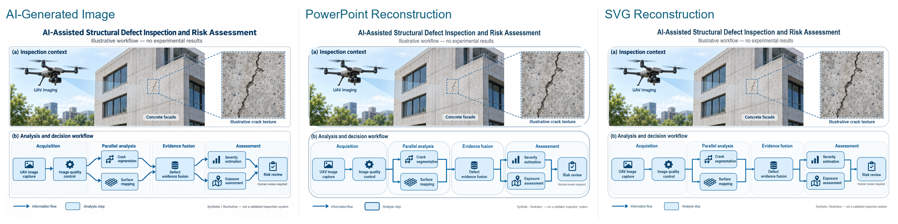
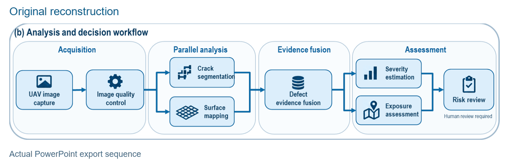

# Scientific Figure Reconstruction Skill

**English** · [简体中文](README.zh-CN.md)

**Turn scientific images into figures you can keep editing.**

When preparing a paper, grant proposal or presentation, you might start with an AI-generated diagram or an existing reference image. The overall layout works, but changing a term, moving a node or adjusting an arrow means working with a flat PNG/JPEG.

Scientific Figure Reconstruction Skill aims to recover useful editable structure from that image. It rebuilds supported text, shapes and connections in **PowerPoint and SVG**, while keeping complex illustrations as image assets, so you can continue editing instead of drawing everything again.

[Examples](#examples) · [Quick start](#quick-start) · [Editability](#outputs-and-editability) · [Roadmap](docs/roadmap.md)

## Examples

**AI-generated scientific figure → editable PowerPoint → SVG.**

This illustration was generated with OpenAI's built-in image tool. The experimental output uses the recorded PNG-only Authoring Proposal and a local diagnostic layering repair; the current public Skill does not automatically reproduce this result.

[](assets/showcase/ai-comparison.png)

*Experimental reconstruction. Workflow text, nodes and connectors are editable; some illustrations remain raster assets.*

The result contains **8 native workflow nodes and 9 attached PowerPoint connectors**. Fonts, arrows and layout differ from the source. Retained icons are independent images and do not automatically move with their nodes. [Result and validation details](docs/showcase.md).

[AI-generated PNG](examples/showcase-ai/original-ai-image.png) · [PowerPoint draft](examples/showcase-ai/unverified-draft.pptx) · [SVG draft](examples/showcase-ai/unverified-draft.svg)

### Continue editing in PowerPoint



An **actual PowerPoint export sequence** from this same AI-image reconstruction, showing recorded text changes, node moves/resizes and save/reopen. [Editing scope](docs/showcase.md).

The earlier program-generated UAV diagram remains a [separate example](examples/showcase-uav/README.md).

## Features

- **Native text and shapes:** rebuild supported labels, workflow boxes and regular containers as editable objects.
- **Attached connectors:** connect identified PowerPoint nodes so endpoints follow their movement.
- **Representation-aware reconstruction:** use native/vector elements for supported structure and preserve complex scientific regions as separate raster assets.
- **PowerPoint and SVG output:** continue editing labels, object geometry and layout.
- **Scientific-content checks:** retain terms, values and relation directions; preserve uncertain content where possible and report what needs review.

## Quick start

### Requirements

Use **Windows x64, Python 3.12 and a signed-in Codex desktop client or CLI** that supports local Skills. Actual desktop rendering and PowerPoint editing also require user-installed **PowerPoint 16, Edge and Windows PowerShell**, with suitable installed fonts such as Arial.

The default **Codex Host-Managed Skill** uses your signed-in account and its applicable quota; no separate OpenAI API key is needed. [Independent API mode](docs/optional-api.md) is optional.

### 1. Install

From the repository root, run in PowerShell:

```powershell
py -3.12 -m venv .venv
.\.venv\Scripts\python.exe -m pip install --isolated --index-url https://pypi.org/simple --only-binary=:all: --require-hashes -r requirements.lock
.\.venv\Scripts\python.exe -m pip install --isolated --index-url https://pypi.org/simple --only-binary=:all: --require-hashes -r requirements-build.lock
.\.venv\Scripts\python.exe -m pip install --no-deps --no-build-isolation .
.\.venv\Scripts\python.exe -m pip check
```

### 2. Use the Skill

Open the repository in Codex, or run `codex -C <repository-root>`. The Skill lives at [`.agents/skills/scientific-figure-reconstruction/SKILL.md`](.agents/skills/scientific-figure-reconstruction/SKILL.md); in CLI, find it with `/skills` or invoke it by name.

Place your approved PNG/JPEG at `inputs/figure.png` and ask:

```text
Use $scientific-figure-reconstruction on inputs/figure.png.
Preserve the labels and relationships, use fresh output folders,
and produce editable PPTX/SVG. Explain which regions remain images.
Stop before separate desktop rendering.
```

### 3. Generate and view the result

The Skill prepares the image, authors a structured Proposal and generates both outputs. Run desktop rendering separately in a normal, non-elevated Windows desktop terminal.

<details>
<summary>Local preparation and rendering commands</summary>

```powershell
.\.venv\Scripts\ufigure.exe prepare --workspace . --image inputs/figure.png --out runs/p
# Codex views runs/p/input.png and writes runs/p/proposal.json.
.\.venv\Scripts\ufigure.exe serialize --workspace . --image runs/p/input.png --proposal runs/p/proposal.json --out runs/i
# Run separately from the model sandbox in the trusted Windows desktop:
.\.venv\Scripts\ufigure.exe desktop-render --workspace . --artifacts runs/i --out runs/d
```

Use new output directories for each run.

</details>

PPTX/SVG and structured records are under `runs/i/`; actual renders and comparisons are under `runs/d/desktop/`. [Complete host workflow](docs/host-managed.md).

Authoring uses the Codex service and may transmit the image and host context. Codex manages tools, file permissions and sandbox settings; desktop rendering is a separate local step. [Security and privacy](SECURITY.md).

### Offline Smoke Test

The three-node **Acquire → Validate → Report** fixture checks the local pipeline without model inference. It uses the supplied example Proposal.

```powershell
.\.venv\Scripts\ufigure.exe serialize --workspace . --image examples/workflow.png --proposal examples/proposal.json --out runs/smoke
# User-run desktop rendering, when PowerPoint and Edge are available:
.\.venv\Scripts\ufigure.exe desktop-render --workspace . --artifacts runs/smoke --out runs/smoke-render
```

[Basic example and verification](docs/verification.md).

## Outputs and editability

| Element | Editing behavior |
|---|---|
| Native PowerPoint text | Change labels, fonts and text geometry |
| Workflow nodes and regular containers | Move/resize objects; tested labels follow their containers |
| Attached PowerPoint connectors | Endpoints follow connected nodes, including in the tested save/reopen workflow |
| SVG text and vector geometry | Edit text and paths; connectors are static, without Office-style attachment |
| Preserved image assets | Move/scale the whole region; internal content remains pixels |

Editing coverage depends on the image. Complex scientific illustrations and chart data can remain raster; moving a connector does not automatically resolve layout collisions.

## How it works

```text
PNG/JPEG
   ↓
Codex visual authoring → structured Proposal
   ↓
CanonicalFigure → validation and representation selection
   ↓
PPTX / SVG Writers → desktop rendering and editing review
```

Supported regular elements become native structure; difficult textures and scientific illustrations retain their original visual content. [Representation choices and research directions](docs/roadmap.md).

## Current version and roadmap

**Research Preview**, prepared for the first `v0.1.0-preview.1` release; its accepted core remains frozen. The current scope is structured workflows, technical flowcharts and simple scientific schematics. Full reconstruction of complex AI-generated diagrams, general irregular-object separation and Linux/WSL operation still need further work or verification.

Future work includes more coherent object grouping, transparent layers, selective vectorization and finer scientific-object reconstruction. FAST / BALANCED / HIGH are research directions rather than three finished product modes. [Roadmap](docs/roadmap.md).

For recorded scope, see [showcase details](docs/showcase.md) and [basic example verification](docs/verification.md). [AI-image experiment notes](docs/experimental-ai.md) explain the diagnostic repair behind the main demonstration.

## License and acknowledgements

**MIT License · Copyright (c) 2026 Fang Zhe.**

[LICENSE](LICENSE) · [Third-party notices](NOTICE.md) · [Provenance](PROVENANCE.md) · [Showcase sources](docs/showcase-provenance.md)

Historical SF/I2P method references are acknowledged in the notices. Third-party works retain their own licenses. AI-source imagery and derived showcase files use **CC BY 4.0**; see the [asset attribution and license](examples/showcase-ai/ASSET_PERMISSION.md).

Maintained by [Fang Zhe](https://github.com/fun4fang).
