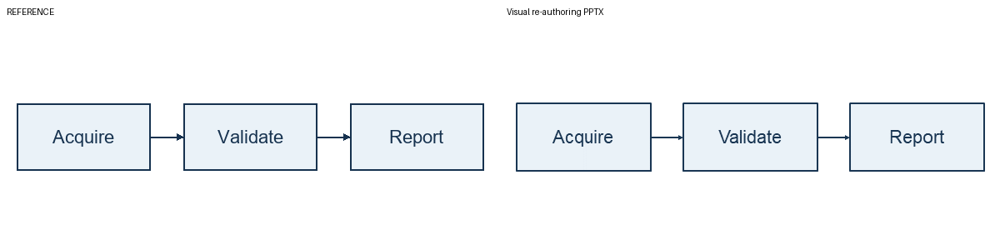
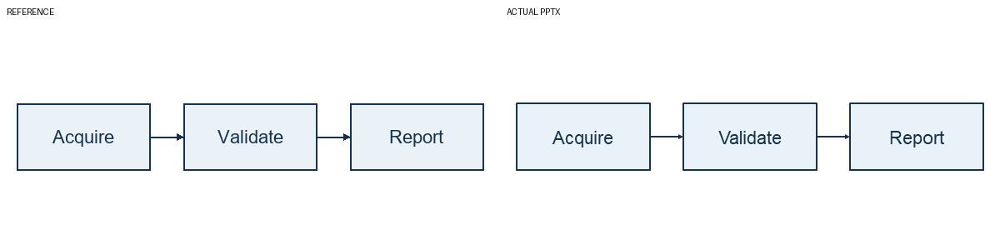
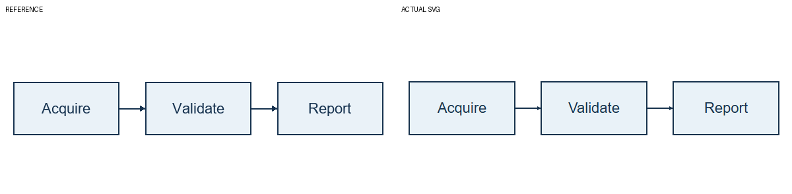

# Validation scope — 2026-10-12

This is a local Research Preview candidate, not a published release. The bounded
checks below apply to one original three-node diagram and this Windows runtime.

| Check | Actual result and limit |
|---|---|
| Clean install | PASS: separate source copy/fresh Windows x86-64 CPython 3.12 venv; runtime and build hashes installed, package/pip-check/help/tests/PNG/JPEG commands passed; no old Skills, Node junctions or private resources |
| Installation incident | First index resolution found no rpds-py distribution; identical lock/version/hash retry succeeded. Failed log retained; no pin substitution |
| Offline PNG/JPEG | PASS: known synthetic proposal through installed entry, CanonicalFigure/safety/Writers and actual PowerPoint/Edge renders; no model calls |
| Historical Codex image-only flow | PASS on workflow.png: gpt-5.6-luna, one initial plus one actual-render correction, no manual proposal replacement; 3 native containers/2 directed connectors/no raster |
| Model-output PowerPoint editing | PASS: native text change, label/container move, resize, move both endpoint objects, save/close/reopen and actual render; no reconnect; endpoint error <0.1pt |
| SVG editing | PASS: native text/tspan/group edit, save/reparse and actual Edge render; GUI vector editor NOT_VERIFIED; connector following STATIC_ONLY |
| Targeted security | 20 offline tests PASS: HTTP capture, host file canaries, correction, no tool/auth fallback, redirects/budgets, ADS/illegal names, actual NTFS junction/hardlink, collisions and intact raster references |
| Actual fail-closed entry | 7 negative commands PASS: uncertain relation, source/native overlap, unsupported background, bounds, traversal, overwrite and absent remote consent |
| Independent Skill | Root/canonical Skill validators PASS; actual codex-cli 0.162.0-alpha.17.2 local skills/list found one enabled repo Skill, without thread/turn start. Desktop UI selector NOT_VERIFIED; actual new CLI/app-server activation and image-only Authoring PASS (one initial phase, no correction/fixture) |
| Host handoff | 23 total offline tests PASS (20 retained security plus 3 handoff tests); prepare -> known synthetic Proposal -> existing installed realize/Canonical/scientific/Writers -> real Office/Edge renders PASS with API keys removed. Four PPTX/SVG/render hashes unchanged. Duplicate/traversal/ADS/uncertain-relation negative entries fail closed. No inference executed |
| Algorithm preservation | One original synthetic fixture has byte-identical canonical/PPTX/SVG and both render PNGs versus unchanged core; not full regression |
| SVG helper | Prior 280 serialized-element parity cases retained; source-unclear helper excluded |
| Template | Independent v4 generator reproduces shipped bytes; real Office attachment/edit/save/reopen evidence reused by exact resource hash, plus current candidate/model outputs |
| Dependency notices/advisories | 9 exact runtime/build packages, 44 full supplied license/notice files; OSV no matched advisories on 2026-10-12, not all bundled native/zero-day coverage |
| Model isolation | Replacement zero-tool explicit API request, no host context/discovery; verified with offline mocks. Legacy Agent analyze hard-disabled; historical zero tool events are not isolation proof |
| Scope not verified | Unknown real diagrams/generalization, adversarial Provider prompt injection, Linux/WSL rendering, GUI SVG connector editing |

All three labels and two directions survived. The correction restored visible
outline thickness. One-pixel box-size, text baseline/metrics and arrow differences
remain. Human scientific review is still required; model inventory/confidence
is not trusted ground truth. E2/V3 samples were not rerun or used as new holdouts;
PHASE_7_ENTRY_GATE = FAIL_UNCHANGED.

See [offline receipt](../examples/result/verification.json) and
[authorized model receipt](../examples/agent-result/verification.json).
The two model calls consumed 23,489 input and 4,011 output tokens in reported
usage; monetary cost was not measured. This is historical usage. The later
new host session used one initial Authoring phase; no further inference or
correction was used during trusted-desktop verification.

The initial boundary test's PNG verify/EXIF ordering defect was repaired locally.
The initial Provider call's ignored view-image setting was repaired before the
sole correction. No scientific validation was relaxed. Lab source/hash evidence
was preserved. Private traces, paths, Office-save derivatives, environments,
build products and Git history are excluded from the candidate.

The final review identified SEC-01 (host context/tools) and SEC-02 (ID to NTFS
stream). SEC-02 shared file/asset guards and optional zero-tool API proofs remain.
Default positioning is now Codex Host-Managed Skill, not API-only dispatch.
SEC-01's strict zero-extra-read claim is **not applicable to default host mode**;
host permissions/context/tools are its own boundary, not locally attested.
Local prepare/serialize/realize safeguards remain technical constraints. The
new host Skill activated under recorded workspace-write/network-disabled command
settings and authored only the original example without historical answers.
Direct Office COM rendering failed under that sandbox and remained failed.
A separate human-authorized trusted Windows desktop handoff completed existing
SVG Writer output, PowerPoint/Edge renders and native editing/save/reopen with
no model calls or permission changes. See the public scoped receipt below.
This validates the limited host-plus-desktop workflow, not arbitrary-host
isolation or a Desktop UI selector. Final public approval remains required.
Historical Phase 7 FAIL is unchanged. Prior API proofs are not host isolation proof.

[Current host/desktop receipt](../examples/host-result/verification.json): all
three labels and both directions present once, no visible masking/occlusion;
minor font/border differences. SVG remains STATIC_ONLY. Edited-save derivatives,
raw host prompts/traces/paths and probe fixtures stay in private verification.
