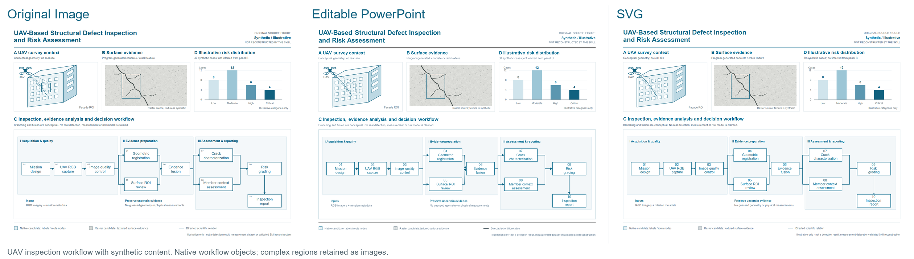
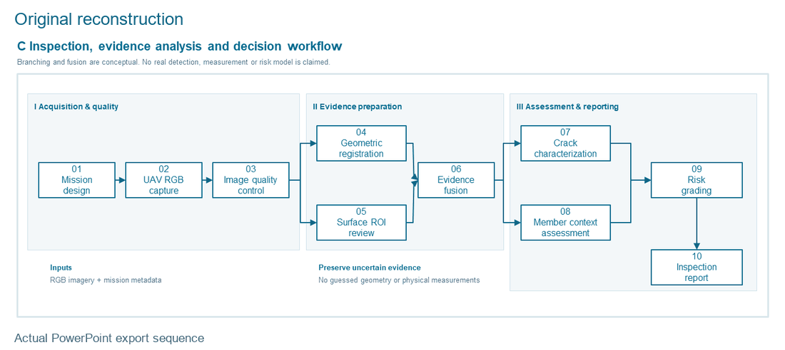

# Program-generated UAV example

This earlier input is an original program-generated scientific diagram with
synthetic data, **not an AI-generated image**. The new AI-image experiment is
the homepage Hero; this example retains its separate partial reconstruction
and original bounded editing verification.

[Original PNG](original-reference.png) · [PPTX](reconstructed.pptx) ·
[SVG](reconstructed.svg) · [Original verification](verification.json)

Actual PowerPoint export sequence, not continuous UI recording. The ten native
containers and eleven attached relations passed bounded edit/save/reopen checks;
three exact source regions remain raster. Font, index, border and arrow differences
remain. Source images, outputs, GIF and verification receipt are unchanged.

[Full scope](../../docs/showcase.md#program-generated-uav-secondary-example)
